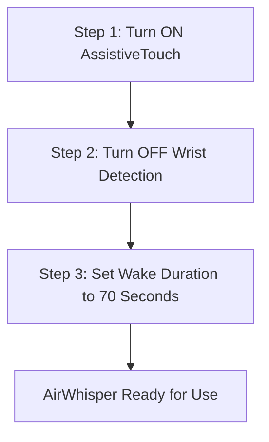
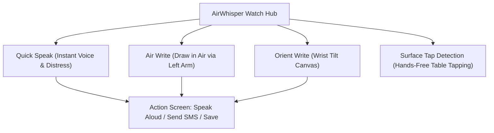
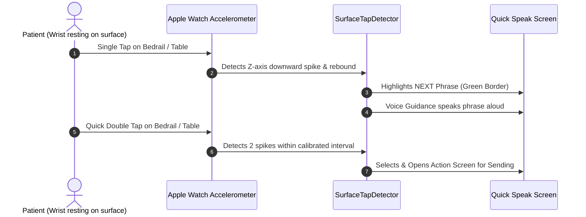
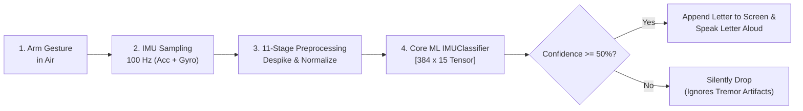
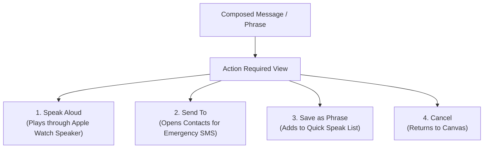
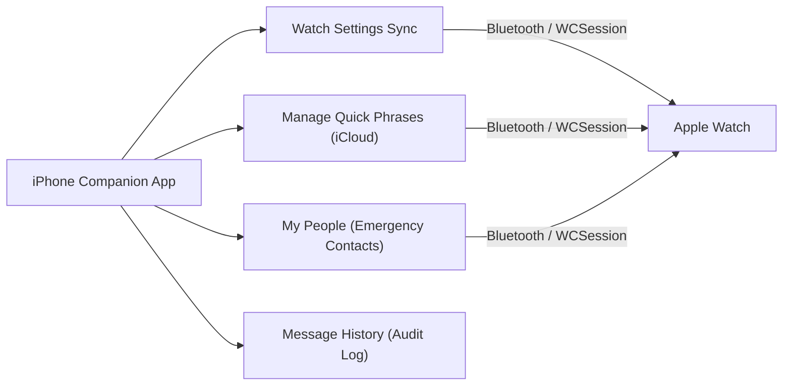

# AirWhisper: Complete System & User Operation Guide

> **Empowering non-verbal and motor-impaired individuals through gesture-driven wearable communication.**

---

## 1. Clinical Context & Target Audience

### Who AirWhisper Is Built For
AirWhisper is an assistive wearable communication system designed for individuals who have lost the ability to speak fluently or operate standard touchscreens due to severe motor impairments, neurological conditions, or physical trauma.

### Target Medical Conditions
The app is engineered to address the specific physical and neurological constraints of:

1. **Parkinson’s Disease**: Severe resting or action tremors, bradykinesia (extreme slowness of movement), and limb rigidity that make touching small screen buttons virtually impossible.
2. **Amyotrophic Lateral Sclerosis (ALS)**: Progressive loss of voluntary muscle control, speech dysarthria, and finger dexterity, while retaining gross arm or wrist mobility in early-to-mid stages.
3. **Post-Stroke Conditions (Hemiplegia / Aphasia)**: Loss of functional use of one side of the body, fine motor coordination deficit, and expressive language difficulty.
4. **Traumatic Brain Injury (TBI)**: Coordination disorders, tremors, ataxia, and cognitive-motor dissociation.
5. **Road Traffic Accidents (RTA) & Spinal Trauma**: Quadriparesis or upper limb trauma where vocal cords or fine finger joints are immobilized.

---

### The Global Crisis in Augmentative Communication (AAC)

* **26.3 Million individuals globally** rely on Augmentative and Alternative Communication (AAC) solutions.
* **Patient Severity Breakdown**:
  * **Mild Motor Impairment**: 17.5%
  * **Moderate Motor Impairment**: 43.8%
  * **Severe Motor Impairment**: 38.7%
* **Why Traditional AAC Fails**:
  * **Touchscreen AAC Apps** demand high-precision finger pointing and steady hands; for tremor patients, every tap triggers accidental mis-hits and frustration.
  * **Eye-Tracking Rigs** cost thousands of dollars, require rigid head calibration, and cannot be used while in bed or during transit.
  * **Result**: Profound isolation, inability to alert caregivers to acute pain, and unmet basic needs.

**AirWhisper's Breakthrough**: Instead of requiring finger precision on a screen, AirWhisper transforms the sensors already on an Apple Watch (accelerometer, gyroscope, and attitude sensors) into an intuitive, touchless communication terminal.

---

## 2. Essential Apple Watch Setup (Do This First!)

Before launching AirWhisper on the Apple Watch, you **must configure three critical watchOS settings**. These steps ensure the watch does not prematurely sleep, lock itself due to tremors, or require tiny touch taps.

### Step 1: Turn ON AssistiveTouch & Hand Gestures
* **Why**: AssistiveTouch enables patients with tremors or partial paralysis to control the watch without touching the display screen, using simple hand clenches or finger pinches.
* **How to Configure**:
  1. Open the **Settings app** on the Apple Watch (or the **Watch app** on the paired iPhone).
  2. Scroll down and tap **Accessibility**.
  3. Select **AssistiveTouch** and toggle it **ON**.
  4. Tap **Hand Gestures** and toggle **Hand Gestures ON**.
  5. *Recommended default shortcuts*:
     * **Pinch**: Move forward to next element.
     * **Double Pinch**: Move backward.
     * **Clench**: Tap / Select active element.
     * **Double Clench**: Activate Action / Quick Actions.

### Step 2: Turn OFF Wrist Detection
* **Why**: When patients with tremors, contractures, or paralysis rest their arms on hospital beds, wheelchair trays, or table surfaces, standard Apple Watch wrist sensors often lose contact or misread skin proximity. This causes watchOS to instantly lock the screen with a passcode prompt and shut down active motion sensors. Turning Wrist Detection OFF keeps the watch perpetually active and unlocked.
* **How to Configure**:
  1. Open the **Watch app** on the paired iPhone (or **Settings** directly on the Apple Watch).
  2. Tap **Passcode**.
  3. Scroll to the bottom to find **Wrist Detection**.
  4. Toggle **Wrist Detection OFF**.
  5. Confirm the prompt on screen.

### Step 3: Increase Wake Duration to 70 Seconds ("Wake Off Time")
* **Why**: By default, an Apple Watch display dims and sleeps after just 15 seconds of inactivity. Patients suffering from bradykinesia or tremors require more time to start an arm stroke, review recognized letters, or trigger a tap. Setting the screen wake time to 70 seconds prevents the app from sleeping mid-word.
* **How to Configure**:
  1. Open **Settings** on the Apple Watch.
  2. Tap **Display & Brightness**.
  3. Scroll down and tap **Wake Duration**.
  4. Change the selection from *Wake for 15 Seconds* to **Wake for 70 Seconds**.

---

## 3. Core Features Breakdown & How to Use

---

### Feature 1: Quick Speak (Immediate Vocal Phrases)

* **What it is**: A high-contrast list of priority phrases designed for instant medical and personal communication without spelling letter-by-letter.
* **Key Mechanisms**:
  * **"HELP" is Permanently Pinned**: The emergency distress button is always at the top of the screen.
  * **Dynamic Recency Sorting**: When a patient uses a phrase (e.g., *"I'M IN PAIN"* or *"WATER"*), that phrase automatically promotes to the top of the list for quick re-access.
  * **Capacity Limit & Auto-Pruning**: Stores up to 10 active phrases. When the list is full and a new phrase is added, the least-used phrase is automatically replaced.
* **How to Use**:
  1. Open the AirWhisper Watch App. The home screen defaults to **Quick Speak**.
  2. Scroll or browse with AssistiveTouch to the desired phrase.
  3. Tap the phrase (or select via Surface Tap).
  4. The **Actions screen** appears:
     * Tap **Speak Aloud** $\rightarrow$ Watch synthesizes speech immediately through the built-in speaker.
     * Tap **Send To** $\rightarrow$ Dispatches the phrase as an SMS to an emergency contact.

---

### Feature 2: Surface Tap Detection (Hands-Free Table Navigation)

> [!IMPORTANT]
> **Who it is for**: Patients who have severe muscle fatigue or tremor tremors that prevent them from performing finger pinches, clenches, or touchscreen taps.

#### What is Surface Tap?
Patients rest their wrist or hand naturally on any rigid or semi-rigid surface—such as a hospital bedrail, bedside tray table, armchair, or their own thigh. By simply tapping their index finger or hand on that surface, micro-vibrations travel through the wrist to the Apple Watch accelerometer.

#### How It Works:
* **Single Tap $\rightarrow$ Move Focus**:
  * Every single tap advances the highlight cursor to the next Quick Phrase or action button.
  * The focused item is framed in a bright green outline.
  * **Voice Guidance** instantly speaks the phrase name aloud through the speaker so the patient doesn't even need to look at the screen.
* **Double Tap $\rightarrow$ Select & Trigger**:
  * Two quick successive taps confirm the highlighted phrase and open the send/action view.

#### One-Time Watch Calibration Flow:
1. Enable **Tap Detector** in the iPhone Companion App under *Watch Settings*.
2. The Apple Watch will automatically present the **Tap Calibration Screen**:
   * **Phase 1: Single Taps**: Tap the surface 3 times (press Record $\rightarrow$ tap once $\rightarrow$ press Stop). The detector measures your unique downward shock peak ($Z \le -0.5\text{g}$) and rebound peak ($Z \ge +0.2\text{g}$).
   * **Phase 2: Double Taps**: Perform 3 double taps. The detector measures your natural inter-tap rhythm and timing window ($\approx 0.4\text{s} \pm 0.25\text{s}$).
3. Once calibration completes, the watch confirms with a green checkmark and saves your personalized tremor filter thresholds.

---

### Feature 3: Air Write (Character-by-Character Air Gesture Recognition)

* **What it is**: Allows the patient to write freeform words and custom sentences letter-by-letter simply by tracing capital letters in the air with their arm.
* **Mandatory Rule**: **Must be worn on the LEFT wrist**. The underlying machine learning model was trained specifically on left-arm kinetic kinematics.

#### The Step-by-Step Character Recognition Pipeline:

#### Detailed Breakdown of How a Letter is Made:
1. **Starting the Stroke**:
   * Patient opens **Air Write** from Writing Modes.
   * Tap the blue **Start** button (or clench with AssistiveTouch). Voice guidance announces *"Start Recording"*.
2. **Drawing in the Air**:
   * The patient moves their arm to draw the shape of a single uppercase letter (e.g., 'A', 'H', 'E') in the air as if writing on a large transparent wall.
   * Motion should be broad and fluid (driven from the elbow and shoulder rather than finger twitches).
3. **Stopping the Stroke**:
   * Tap the red **Stop** button (or clench). Voice guidance announces *"Stop Recording"*.
4. **Behind-the-Scenes Signal Processing**:
   * The watch records 6 axes of motion at **100 Hz** (3-axis rotation rate + 3-axis world acceleration).
   * **11-Stage Preprocessing Pipeline**:
     * Removes sensor latency gaps and flatlines.
     * Despikes erratic high-frequency tremor noise ($Z$-score filter).
     * Calculates kinetic energy profiles: $\text{gyroEnergy}$, $\text{accEnergy}$, and cumulative energy progress.
     * Interpolates the stroke into a standard tensor of **384 time steps $\times$ 15 features**.
5. **Core ML Classification**:
   * The on-device neural network (`IMUClassifier`) analyzes the motion tensor and computes probability distributions across all 26 uppercase alphabet letters.
   * **D vs P Disambiguation Head**: Because 'D' and 'P' share identical starting downward strokes, a specialized secondary classifier head evaluates the curvature and loop closure to avoid confusion.
6. **Confidence Thresholding (Noise Rejection)**:
   * **Confidence $\ge 50\%$**: The recognized letter is appended to the message line and pronounced aloud (*"A!"*) via text-to-speech for instant verification.
   * **Confidence $< 50\%$**: If the stroke was distorted by an involuntary tremor spasm, the app safely drops the prediction instead of typing garbled characters.
7. **Forming Full Words & Sentences**:
   * Repeat for the next letter. Characters chain together in the message display box.
   * **Backspace ($\leftarrow$)**: Tapping the delete button removes the most recent character.
   * When finished, tap **Done** to proceed to the Actions screen.

---

### Feature 4: Orient Write (Wrist-Tilt Virtual Canvas)

> [!NOTE]
> **Who it is for**: Patients who have resting tremors or weakness that prevents them from lifting their entire arm into the air, but who can tilt their wrist left/right and up/down.

* **How the Virtual Canvas Works**:
  * The watch display shows a blank writing canvas with a responsive cursor.
  * **Roll (Tilt wrist left / right)** $\rightarrow$ Moves the cursor horizontally ($X$-axis).
  * **Pitch (Tilt wrist forward / backward)** $\rightarrow$ Moves the cursor vertically ($Y$-axis).
  * **Dead-Zone Tremor Filtering (0.05 rad)**: Minor involuntary tremor shakes are filtered out, keeping the cursor stable.
* **How to Write**:
  1. Hold your wrist steady until the cursor stabilizes.
  2. Tap **Start**: The cursor turns **green**, signifying the "pen is down" and drawing.
  3. Tilt your wrist smoothly to guide the green cursor and trace the letter shape.
  4. Tap **Stop**: The pen lifts, and stroke coordinates are transmitted to the recognition engine.
  5. The letter is recognized, appended to your message, and spoken aloud.

---

### Feature 5: Sending Messages & The "Action Required" Screen

Once a message is composed via Air Write or Orient Write—or selected from Quick Speak—the user lands on the **Actions Screen**:

1. **Speak Aloud**:
   * Plays the full sentence through the Apple Watch speaker at full volume using iOS speech synthesis. Allows immediate in-room communication with doctors, nurses, or caregivers.
2. **Send To (Emergency SMS Dispatch)**:
   * Navigates to the **Contacts Selection Screen** displaying verified contacts synced from the iPhone.
   * Tap the recipient contact $\rightarrow$ The watch immediately sends the text message via the cloud SMS gateway (Render + Twilio backend).
   * A delivery confirmation alert appears on the watch, and the message is automatically logged into the iPhone companion app's **Message History**.
3. **Save as Phrase**:
   * Saves the newly composed custom message directly into Quick Speak for instant future access.

---

## 4. Character-by-Character Air Write Guide (A to Z)

To achieve maximum recognition accuracy, draw each letter with confident, continuous motions using your left arm.

Below is the stroke guidance for each letter, corresponding to the reference videos bundled in the app:

| Letter | Starting Point | Air Stroke Path & Motion Direction | Tip for Tremor Patients |
| :---: | :---: | :--- | :--- |
| **A** | Bottom Left | Sweep up diagonally to apex, down diagonally to bottom right, loop back across the center bar. | Draw as one continuous triangular motion without lifting arm. |
| **B** | Top Left | Move straight down, trace back up stem, sweep top rounded loop, continue into bottom rounded loop. | Keep the two loops distinct and round. |
| **C** | Top Right | Sweep up slightly, curve left in a broad arc, and sweep down and right to finish. | Broad elbow circle helps prevent flat arcs. |
| **D** | Top Left | Draw straight downward vertical stem, sweep back to top and arc out in a large rightward curve. | D vs P classifier looks for the full bottom closure. |
| **E** | Top Right | Trace top horizontal bar to left, down the vertical spine, sweep bottom bar, loop into middle bar. | Keep the vertical spine straight. |
| **F** | Top Right | Trace top horizontal bar to left, straight down the vertical spine, loop up to middle crossbar. | Similar to E, but finish after the middle bar. |
| **G** | Top Right | Trace circular C-curve counter-clockwise, sweep up on right side, and push horizontally inward. | Accentuate the horizontal inward hook. |
| **H** | Top Left | Down left stem, cross over to right side, down right stem, cross back through center bar. | Draw as an inverted N or fluid double upright. |
| **I** | Top Center | Straight vertical downward stroke from top to bottom. | A crisp, decisive vertical drop works best. |
| **J** | Top Right | Sweep left across top bar, straight down center, curve up into a leftward bottom hook. | Make the bottom hook prominent. |
| **K** | Top Left | Down vertical stem, move up and diagonally right, pull into center, sweep diagonally down-right. | Emphasize the distinct diagonal junction. |
| **L** | Top Left | Straight downward stroke, sharp corner into a horizontal line to the right. | Pause slightly at the corner to register the angle. |
| **M** | Bottom Left | Up to top left, down diagonal to center, up diagonal to top right, down to bottom right. | Make both peaks high and sharp. |
| **N** | Bottom Left | Up vertical left stem, sharp diagonal down to bottom right, straight up to top right. | Distinct diagonal descent gives clear signature. |
| **O** | Top Center | Smooth counter-clockwise circle returning to the starting point. | Big, wide circular arm sweep. |
| **P** | Bottom Left | Up vertical stem, curve around top right in a single closed half-circle loop back to stem. | Do not draw lower loop (distinguishes from B). |
| **Q** | Top Center | Draw a full circle (O), pause at bottom right, sweep a short diagonal tail downward-right. | Make the tail flick distinct. |
| **R** | Bottom Left | Up stem, round top loop to center of stem, sweep diagonal rightward leg downward. | Keep the bottom diagonal leg extended. |
| **S** | Top Right | Curve left, sweep diagonally down across center, curve right and sweep under to bottom left. | Fluid serpentine S-curve; avoid stopping halfway. |
| **T** | Top Left | Horizontal bar left to right, return to center, straight downward stroke. | Keep the horizontal top bar wide. |
| **U** | Top Left | Downward vertical stroke, rounded bottom cup, straight upward vertical stroke to top right. | Keep bottom rounded, not pointed. |
| **V** | Top Left | Diagonal sweep down to center point, diagonal sweep up to top right. | Make the bottom junction sharp. |
| **W** | Top Left | Down diagonal, up to middle, down diagonal, up to top right. | Inverted M; keep valleys sharp. |
| **X** | Top Left | Diagonal stroke down to bottom right, loop over, diagonal stroke from top right to bottom left. | Distinct cross-intersection. |
| **Y** | Top Left | Short diagonal to center, short diagonal from top right to center, straight stem downward. | Keep the downward tail centered. |
| **Z** | Top Left | Horizontal right, sharp diagonal down to bottom left, horizontal right. | Exaggerate the top and bottom parallel horizontal lines. |

---

## 5. iPhone Companion App Setup & Management

The iPhone companion app manages backend data, contact books, phrase synchronization, and custom sensitivity settings.

### 1. Watch Settings
* **Motion Sensitivity Slider**: Adjusts cursor speed in Orient Write from 0% (high dampening for heavy tremors) to 100% (high agility).
* **Voice Guidance Toggle**: Toggles auditory speech feedback on the watch for every focused element and recognized letter.
* **Tap Detector Toggle**: Activates or deactivates the surface tap accelerometer engine on the watch.

### 2. Managing Quick Phrases
* Open **Manage Quick Phrases** from the home screen.
* Enter common needs (e.g., *"Please adjust my pillow"*, *"I need suction"*, *"Yes"*, *"No"*).
* Changes automatically sync to the Apple Watch over Bluetooth in real-time.

### 3. My People (Emergency Contacts)
* Save emergency phone numbers for family members, nurses, or caregivers.
* When "Send To" is triggered on the watch, these contacts are displayed with instant one-tap SMS delivery.

### 4. Message History
* Review chronological records of all distress phrases and custom messages sent from the watch, complete with recipient names and timestamps.

---

## 6. Quick Troubleshooting & Best Practices

| Symptom / Issue | Probable Cause | Immediate Remedy |
| :--- | :--- | :--- |
| **Watch screen goes black while drawing** | Wake duration is set to default (15 seconds). | Open Apple Watch Settings $\rightarrow$ Display & Brightness $\rightarrow$ Wake Duration $\rightarrow$ Set to **70 Seconds**. |
| **Passcode prompt appears during arm movements** | Wrist Detection is ON and sensor lost contact during tremor. | Open Apple Watch Settings $\rightarrow$ Passcode $\rightarrow$ Turn **Wrist Detection OFF**. |
| **Letters are consistently misrecognized** | Watch is being worn on the right hand. | **Air Write requires the LEFT hand**. Move the watch to your left wrist. |
| **Surface Tap does not detect single taps** | User taps too lightly or calibration thresholds do not match surface. | Tap **Recalibrate** on the watch and perform 3 firmer baseline taps. |
| **SMS messages fail to send** | iPhone is disconnected or phone number format is invalid. | Ensure iPhone has cellular data/Wi-Fi and contacts have valid international dialing codes (+ prefix). |

---

## 7. Verbatim "How to Use" Steps From the App

Below are the exact, step-by-step instructions displayed inside each feature's **How to Use** screen in the AirWhisper app:

### 1. AirWrite — How to Use
* **What is AirWrite?**
  > AirWrite lets you compose messages by drawing letters in the air using broad arm movements—no typing or screen touch required.

* **Step 1: Wear on your LEFT hand**
  > *Instruction:* The IMU model is trained specifically on left-hand movements. Wearing the watch on your right hand will result in incorrect predictions.
* **Step 2: Draw the letter in the air**
  > *Instruction:* Trace the letter shape with your arm in one smooth motion. Draw exactly as you would if the air were your writing canvas.
* **Step 3: Confidence threshold for accepted letters**
  > *Instruction:* The on-device Core ML model scores each prediction. Only letters meeting the confidence threshold are added and spoken aloud. If the model is unsure, the result is silently dropped needing you to draw the letter again.
* **Letter Reference Carousel:**
  > Browse every letter (A–Z) to see the exact wrist motion used to train the model.

---

### 2. OrientWrite — How to Use
* **How It Works:**
  > OrientWrite allows you to compose messages using wrist movements, including roll (left/right tilt) and pitch (up/down tilt). These wrist motions control the cursor on a virtual canvas, enabling you to draw letters directly on the watch face. As you move your wrist, the cursor follows your gestures, allowing you to write messages intuitively without touching the screen.

* **Step 1: Open OrientWrite on Your Watch**
  > *Instruction:* From the writing modes, tap OrientWrite. A virtual writing canvas will appear, and the watch will begin tracking your wrist movements.
* **Step 2: Keep Your Wrist Steady Before Writing**
  > *Instruction:* A small cursor indicates the current writing position. Hold your wrist still for a moment to allow the cursor to stabilize before you begin writing.
* **Step 3: Move the Cursor Using Wrist Tilts**
  > *Instruction:* Tilt your wrist left or right (roll) to move the cursor horizontally. Tilt it up or down (pitch) to move the cursor vertically. Small unintentional movements are filtered out to help keep the cursor steady and improve writing accuracy.
* **Step 4: Tap Start and Write a Letter**
  > *Instruction:* Tap the Start button to begin recording your input. Use wrist tilts to guide the cursor and trace a letter on the virtual canvas. OrientWrite tracks the cursor's path as you write. When you finish, tap Stop. The cursor turns green to confirm that the stroke has been successfully recorded.
* **Step 5: Wait for Letter Recognition**
  > *Instruction:* Once recording stops, the captured stroke data is processed by the handwriting recognition system. The system analyzes the shape drawn on the canvas, identifies the corresponding letter, and adds it to your message. The recognized letter is also spoken aloud for confirmation. If recognition is unsuccessful, try again.
* **Step 6: Correct Mistakes Using the Backspace Button**
  > *Instruction:* If an incorrect letter is recognized or added by mistake, tap the Backspace (←) button to remove the most recently entered character. This allows you to make corrections without restarting your message.

---

### 3. Surface Tap — How to Use
* **What is Surface Tap?**
  > Some patients were unable to consistently perform gestures like pinch and clench. Surface Tap lets them communicate by tapping any nearby surface - a bed rail, table, or their own leg. The Apple Watch detects the vibration and helps them navigate through Quick Phrases hands-free.

* **Step 1: Turn on Tap Detector in the iPhone app**
  > *Instruction:* Open AirWhisper on iPhone → Home screen → Watch Settings → toggle "Tap Detector" ON. The setting syncs to the Watch over Bluetooth.
* **Step 2: Complete the one-time calibration on the Watch**
  > *Instruction:* The first time Tap Detector is enabled, the Watch opens a calibration screen. You'll tap a surface 3 times for single taps, then 3 times with a quick double-tap. The Watch learns your specific tap force and timing from the accelerometer data and saves it.
* **Step 3: Rest your wrist on any surface**
  > *Instruction:* Place your wrist or hand lightly on a bed, table, chair arm, or any flat surface. No need to move your arm - the vibration from your fingertip travels through your wrist to the Watch.
* **Step 4: Single tap → move to the next phrase**
  > *Instruction:* One light tap advances through your Quick Phrase list and speaks the highlighted phrase aloud. The Watch highlights each phrase in green so you can follow along visually.
* **Step 5: Double tap → select and send the phrase**
  > *Instruction:* Two quick taps in succession confirm the currently highlighted phrase. It opens the send screen so the phrase can be sent as a message.
* **Step 6: Tap Detector works only in Quick Speak**
  > *Instruction:* Surface Tap is active exclusively on the Quick Speak screen. Air Write and Orient Write continue to work via their own controls when the standard mode is active.

---

### 4. Quick Phrases — How to Use
* **What are Quick Phrases?**
  > Quick Phrases are pre-saved sentences that the Apple Watch reads aloud the moment you tap them. "HELP" is always pinned at the top.

* **Step 1: Open the AirWhisper companion app**
  > *Instruction:* Launch AirWhisper on your iPhone and go to the Home screen.
* **Step 2: Tap "Manage Quick Phrases"**
  > *Instruction:* Type a phrase in the text field and tap Add. The phrase appears in the list immediately.
* **Step 3: Use phrases that matter most**
  > *Instruction:* Add up to 10 phrases. If the list is full, the least-used phrase is automatically replaced — you'll see an alert when this happens.
* **Step 4: Phrases sync to your Watch automatically**
  > *Instruction:* Once added, phrases are sent to your Apple Watch over Bluetooth and backed up to iCloud — so they're there even after pairing a new Watch.
* **Step 5: On the Watch, open Quick Speak**
  > *Instruction:* Tap any phrase in the list to have the Watch speak it instantly. The most recently used phrase moves to the top for faster access next time.
